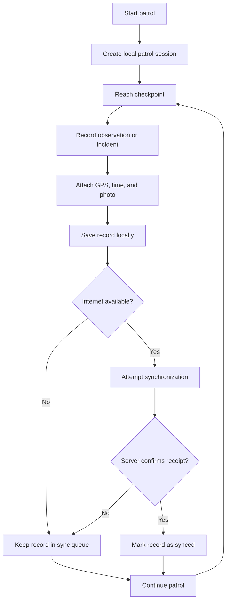
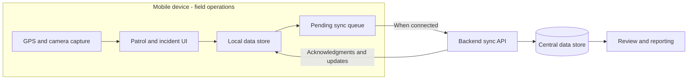
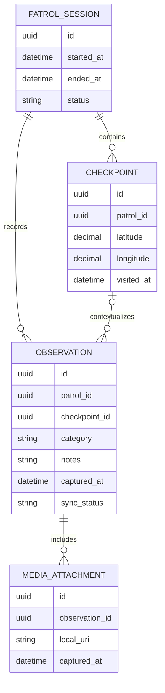

# 🌲 Offline Ranger Companion

**An offline-first mobile application concept for forest patrols, incident documentation, and conservation reporting.**

> **Project status:** This README describes the project's problem statement, proposed solution, architecture, and evaluation plan. Features and outcomes described as *planned* are not claims of a completed deployment. Implementation evidence and measured results should be added as they become available.

<h2 align="center">📱 App Demo</h2>

  

## Overview

Forest rangers and conservation teams often work in remote forests and mountainous terrain where mobile networks are unreliable or unavailable. Yet they still need to document patrol routes, record changes in forest conditions, collect evidence of suspected illegal activity, and report potential fire hazards.

Paper notebooks, disconnected photos, and individual field notes can make this information difficult to consolidate, verify, and retrieve.

**Offline Ranger Companion** aims to support fieldwork without requiring a continuous internet connection. Rangers can capture structured observations on a mobile device, store them locally, and synchronize records with a central system when connectivity returns.

The project connects **software engineering**, **environmental conservation**, and **human-centered design** by focusing on the real operational constraints of people working in the field.

## The Problem

| Field challenge | Why it matters | Proposed response |
| --- | --- | --- |
| Limited or no internet access | Online-only applications may be unusable during a patrol | Offline data entry and local storage |
| Paper-based records | Reports are difficult to search, standardize, and consolidate | Structured digital patrol logs |
| Photos separated from field notes | Evidence can lose its location and time context | Associate photos with GPS coordinates and timestamps |
| Delayed incident reporting | Supervisors may receive important information late | Queue records for synchronization once online |
| Time-consuming report preparation | Manual compilation increases administrative effort | Generate standardized PDF/CSV reports |

## Project Objectives

1. **Work offline by default.** Support essential field operations without an internet connection.
2. **Capture consistent field evidence.** Record patrol sessions, observations, incident categories, location, time, and supporting photographs.
3. **Preserve and synchronize data.** Keep locally saved records available during network interruptions and upload pending changes when a connection is restored.
4. **Improve traceability.** Organize records into a history that can be searched, reviewed, and analyzed.
5. **Make reporting simpler.** Reduce the manual effort involved in preparing patrol and incident reports.
6. **Explore real-world impact.** Evaluate how appropriate mobile technology could support conservation work and sustainable forest management.

## Intended Users

- **Forest rangers:** Conduct patrols, log observations, and document suspected threats.
- **Forest protection teams:** Collect and organize field evidence across patrol sessions.
- **Supervisors and administrators:** Review synchronized records and prepare periodic summaries.

## Planned Features

| Capability | Description |
| --- | --- |
| Patrol sessions | Start and end a patrol, with associated time and activity records |
| Checkpoints | Record observations at specific locations |
| Incident documentation | Categorize potential fire hazards, suspected forest damage, and other abnormal events |
| Geotagged evidence | Attach photos with recorded location and capture time, when permissions and sensor data are available |
| Offline persistence | Store entries on the device before any network upload |
| Deferred synchronization | Send locally queued records when network connectivity becomes available |
| Record history | Browse prior patrols and observations |
| Reporting | Export structured information to PDF or CSV |

These are **target capabilities**, not a verified list of released features.

## Example Field Workflow

**Core principle:** The ability to save a field observation must not depend on the availability of a network connection.

## Proposed System Architecture

### Design Principles

**1. Local-first writes**

New observations are written to persistent storage on the device before a sync attempt. A temporary network failure should not prevent the user from continuing a patrol.

**2. Resilient synchronization**

Records should retain a stable identifier and a synchronization state (for example, `pending`, `syncing`, `synced`, or `failed`). The proposed synchronization workflow uses retries after failures and server-side duplicate protection so repeated requests do not create duplicate observations.

**3. Conflict-aware updates**

If the same record is modified on multiple devices, the system needs an explicit conflict policy rather than silently overwriting field evidence. The final policy should be documented and tested during implementation.

**4. Evidence integrity**

Each observation should preserve relevant metadata, such as its capture time, location (when available), associated patrol, and attachment references. The system must distinguish between a missing GPS fix and a valid recorded coordinate.

**5. Usability in difficult conditions**

Field screens should prioritize clear actions, readable labels, minimal typing, and understandable sync status. Usability testing should reflect outdoor constraints rather than only ideal indoor conditions.

### Conceptual Data Model

*This model is illustrative. It is not a representation of a finalized production schema. Optional location values, attachment upload state, and access controls require implementation-specific decisions.*

## Development Methodology

The project is organized around five phases:

| Phase | Focus | Expected artifacts |
| --- | --- | --- |
| **1. Research** | Understand ranger workflows, connectivity constraints, and environmental risks | Problem definition, user personas, use cases |
| **2. Design** | Define field journeys, interfaces, offline storage, and sync behavior | Wireframes, data model, architecture diagrams |
| **3. Implementation** | Build mobile workflows, local persistence, synchronization, and exports | Working prototype, source code, technical documentation |
| **4. Testing** | Simulate disconnections, retries, missing GPS, and device interruptions | Test cases, defect log, usability findings |
| **5. Evaluation** | Demonstrate the system, assess limitations, and reflect on impact | Demo, evaluation report, project presentation |

## Testing and Evaluation Plan

Testing should go beyond whether the application works on a stable Wi-Fi connection.

| Test scenario | Expected behavior |
| --- | --- |
| Create a patrol with airplane mode enabled | Patrol data can be saved and reopened locally |
| Capture observations without internet | Text and supported attachments remain available on the device |
| Lose connectivity during an upload | The record remains queued and can be retried |
| Reconnect after several offline entries | Pending records are synchronized without unintended duplicates |
| Restart the app before synchronization | Previously saved records remain accessible |
| GPS location is unavailable | The application clearly indicates missing location data |
| Export a patrol report | Generated output contains the appropriate structured records |

### How Success Would Be Measured

A future prototype or pilot can be evaluated using:

- **Offline save reliability:** Proportion of attempted offline records successfully persisted.
- **Synchronization success rate:** Proportion of queued records eventually confirmed by the server.
- **Data completeness:** Proportion of observations containing the required fields.
- **Reporting time:** Time required to prepare a report compared with a manual baseline.
- **Field usability:** Task completion rate and feedback from representative users.

**No numerical improvement or field-validation result is claimed in this README.** Benchmarks should be reported only after actual testing, with methodology and sample size disclosed.

## Privacy, Safety, and Limitations

Field records may contain sensitive GPS coordinates, photographs, and information about suspected illegal activity. A real deployment would require appropriate access controls, secure transport and storage, clear data retention rules, and careful handling of lost devices. Exact GPS coordinates of sensitive habitats should not be made public by default.

The application is intended to **support documentation and reporting**, not replace ranger judgment, official procedures, emergency communications, or specialist fire-detection equipment. Offline operation also means that incidents cannot reach a remote office until a working communication channel is available.

## Roadmap

- [ ] Validate workflows with representative field users
- [ ] Create the mobile interface and local data model
- [ ] Implement offline patrol and observation capture
- [ ] Add GPS and photo metadata handling
- [ ] Implement resilient synchronization and duplicate protection
- [ ] Add record history and PDF/CSV export
- [ ] Test connectivity loss, recovery, and data persistence
- [ ] Conduct usability testing and document measured results
- [ ] Publish screenshots, a demo, and technical findings

*Update this checklist to reflect actual implementation progress before presenting the repository as a completed application.*

## Academic and Social Relevance

Offline Ranger Companion is an applied technology project at the intersection of:

- **Computer Science:** Mobile software engineering, persistence, distributed synchronization, and testing.
- **Information Systems:** Structured data collection, operational workflows, and reporting.
- **Environmental Science:** Conservation fieldwork, incident documentation, and forest protection.
- **Sustainability:** Exploring how digital tools can support more consistent stewardship of natural resources.

The project offers an opportunity to investigate a broader engineering question:

> **How can a digital system remain reliable and useful when the environment cannot provide the connectivity that modern applications often assume?**

## Project Evidence and Contributions

To make this repository useful for technical review or university admissions, it should include verifiable artifacts as development progresses: screenshots or a short demo, system diagrams, relevant source code, test results, and a brief reflection on engineering decisions.

**Before submission, document the contributors and their actual responsibilities.** For example, distinguish the work completed independently from work completed with mentors or collaborators. This makes the technical contribution transparent and credible.

## Future Directions

Potential extensions, subject to user validation and available resources, include route visualization, multi-device collaboration, stronger conflict resolution, supervisor dashboards, and trend analysis across patrol reports.

## Conclusion

**Offline Ranger Companion** explores a practical software engineering challenge: enabling dependable data collection in locations where reliable internet access cannot be assumed. Its value lies in the combination of a real conservation problem, explicit technical constraints, and a testable approach to designing software for field conditions.

---

*Project documentation. Feature availability and measurable impact should be verified against the actual implementation before external use.*
